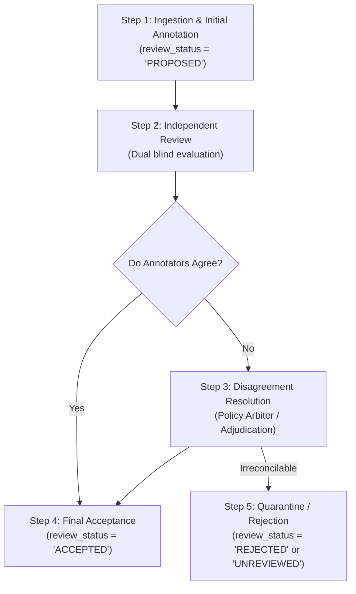

# SafeAd AI / SAFE-VISION Annotation Policy & Moderation Standard

**Document Version**: 2.0.0  
**Scope**: SafeAd AI Multimodal Advertisement Moderation Framework & Dataset Hub  
**Effective Date**: October 2026  

---

## 1. Introduction and Objectives

SAFE-VISION (SafeAd AI) classifies multimodal advertisement creatives (images, video reels, and promotional copy) into four distinct age-safety categories to determine whether an advertisement should be approved for general audiences, age-restricted, or prohibited globally:

1. `SAFE_FOR_ALL`: Unrestricted access across all audiences (0+).
2. `SAFE_14_PLUS`: Accessible only to adolescents aged 14 and above, and adults (14+).
3. `SAFE_18_PLUS`: Accessible strictly to age-verified legal adults (18+).
4. `UNSAFE_FOR_ALL`: Universally prohibited content; rejected across all feeds regardless of user age.
5. `UNASSIGNED`: Reserved exclusively for submodule research components (e.g. facial demographic crops, text guardrails) that are not commercial advertising creatives.

This policy establishes the exact decision boundaries, distinguishes age restriction from universal prohibition, standardizes handling of mixed content and borderline cases, and mandates a verifiable multi-stage annotation review workflow.

---

## 2. Decision Criteria for Core Moderation Classes

### 2.1. `SAFE_FOR_ALL` (General Audiences, All Ages: 0+)
*Content suitable for viewing by children, families, and universal audiences.*

- **Inclusions**:
  - Wholesome everyday food and beverage products, groceries, and household goods.
  - Educational services, books, school supplies, STEM toys, and family entertainment.
  - Consumer electronics, study laptops, office peripherals, gaming accessories (gamepads, keyboards, monitors).
  - General fashion, footwear, casual apparel, and accessories (sneakers, hoodies, hats, backpacks).
  - Civic transit, consumer travel, tourism, sports goods, and general recreation.
- **Exclusions**:
  - Any reference to alcohol, tobacco, vaping, gambling, or regulated adult substances.
  - Weapon depictions, combat violence, graphic injuries, or menacing physical threats.
  - Sexualized imagery, erotic lingerie, suggestive poses, or double entendres.
  - High-stimulant energy drink claims, active chemical medications, or predatory financial claims.
- **Key Clarification**:
  - **Products popular with or marketed to teenagers (e.g. sneakers, gaming gear, musical instruments, hoodies, skateboards) are `SAFE_FOR_ALL` if they contain no mature, violent, or regulated themes.** Youth appeal does not equate to age restriction.

### 2.2. `SAFE_14_PLUS` (Teen-Appropriate Content: 14+)
*Content permissible for adolescents aged 14–17 and adults, but unsuitable for young children under 14.*

- **Inclusions**:
  - **Stylized / Fantasy Action Violence**: PG-13 video game promotions, superhero combat sequences, fantasy anime/manga trailers without graphic mutilation or blood gore.
  - **Intense Entertainment & Thrillers**: Mild horror, suspense film trailers, edgy teenage humor, and mild situational profanity.
  - **High-Stimulant Beverages**: Energy drinks with elevated caffeine concentrations (>150 mg/serving) carrying statutory consumption cautions for young children.
  - **Active / Chemical Topical Skincare**: Medicated blemish treatments (e.g. concentrated salicylic acid, chemical peel serums) carrying minor advisory labels.
  - **Context-Dependent Youth Themes**: Non-graphic combat sport sparring promotions, body-contact sports equipment with intense impact imagery.
- **Exclusions**:
  - Regulated adult products (alcohol, tobacco, casino gambling, lottery, sportsbooks).
  - Graphic real-world violence, bodily trauma, weapons sales, or criminal activities.
  - Explicit sexual content, mature dating services, or adult novelties.
- **Key Clarification**:
  - **Do NOT assign 14+ merely because an ad features athletic movement, teenagers, or fast pacing.** A documented policy rationale (e.g., stylized combat, high caffeine, mild PG-13 suspense) is strictly required.

### 2.3. `SAFE_18_PLUS` (Regulated Adult Content: 18+)
*Lawful commercial advertisements strictly restricted to age-verified legal adults.*

- **Inclusions**:
  - **Alcoholic Beverages**: Beer, wine, spirits, craft breweries, and licensed drinking establishments.
  - **Regulated Gambling**: Licensed sportsbooks, lotteries, online casinos, and horse race betting.
  - **Adult Products & Nightlife**: Mature dating platforms, adult lifestyle products, nightclub promotions.
  - **Age-Restricted Entertainment**: Video games officially rated ESRB M (17+) or PEGI 18, R-rated film promotions.
  - **Statutory Disclaimers**: Permissible only when carrying mandatory age-restriction and responsible-consumption notices.
- **Exclusions**:
  - Content featuring minors, school environments, or cartoon imagery deliberately designed to lure underage consumers into adult vices.
  - Fraudulent gambling promises (e.g. "Guaranteed 100x return overnight") which must be rejected under `UNSAFE_FOR_ALL`.
- **Key Clarification**:
  - **Do NOT assign 18+ solely because of swimwear, activewear, exposed skin, or an automated high NSFW model score.** Legitimate fitness, swimwear, or personal care ads are not adult products unless sexualized or eroticized.

### 2.4. `UNSAFE_FOR_ALL` (Universally Prohibited: REJECT)
*Illegitimate, harmful, or predatory content that must be blocked for all audiences across all feeds.*

- **Inclusions**:
  - **Deceptive Advertising & Financial Scams**: Phishing banners, fake parcel delivery fee notifications, counterfeit gift card generators, "1,000,000th visitor" cash claims, deceptive pyramid/crypto schemes, high-pressure countdown bait.
  - **Brand Impersonation & Counterfeit Products**: Unauthorized use of corporate logos (Amazon, PayPal, Target, Apple) to harvest credentials or payment information.
  - **Prohibited & Regulated Goods**: Illicit narcotics, unauthorized pharmaceuticals, unregulated weapons, explosive devices, contraband trade.
  - **Severe Harm & Exploitation**: Graphic violence, real-world bodily trauma, weapons in assault contexts, hate speech, harassment, sexually explicit or non-consensual exploitation.
- **Exclusions**:
  - Lawful adult products (alcohol, regulated sportsbooks) belong in `SAFE_18_PLUS`, not `UNSAFE_FOR_ALL`. Universal rejection is reserved for illegal, deceptive, or harmful content.
- **Safety Rule**:
  - **UNSAFE_FOR_ALL samples must NEVER appear in the production feed or frontend content catalog.**

---

## 3. Specific Edge-Case Guidance & Policy Rules

| Topic / Scenario | Common Misclassification | Correct Policy Decision | Policy Rationale |
| :--- | :--- | :--- | :--- |
| **Everyday Teen Gear** (Sneakers, hoodies, gaming mice, acoustic guitars) | Misclassified as `SAFE_14_PLUS` due to youth audience. | `SAFE_FOR_ALL` | Universal product. No violence, drugs, suggestive content, or age-gated substances. |
| **Fashion Swimwear / Athletic Gym Wear** | Misclassified as `SAFE_18_PLUS` due to exposed skin or high automated NSFW score. | `SAFE_FOR_ALL` (or `SAFE_14_PLUS` if mildly suggestive) | Non-sexualized commercial apparel. Exposed skin in athletic context is not pornography or adult content. |
| **Tactical / Outdoor Gear** (Cargo pants, combat boots, camping multitools) | Misclassified as `SAFE_18_PLUS` due to keyword "combat" or "tactical". | `SAFE_FOR_ALL` | Utility lifestyle apparel and camping accessories. No assault weapons or prohibited violence. |
| **Energy Drinks / Caffeinated Beverages** | Misclassified as `SAFE_18_PLUS` (confused with alcohol) or `SAFE_FOR_ALL`. | `SAFE_14_PLUS` | Elevated stimulant content (>150 mg caffeine) warrants cautionary guidance for young children (<14). |
| **Combat Sports Equipment** (Boxing gloves, sparring gear) | Misclassified as `UNSAFE_FOR_ALL` (violence) or `SAFE_18_PLUS`. | `SAFE_FOR_ALL` | Regulated athletic fitness gear. Depiction of equipment without graphic blood or battery is general sports equipment. |
| **Deceptive "Free $500 Gift Card" Banner** | Misclassified as `SAFE_FOR_ALL` (shopping promotion). | `UNSAFE_FOR_ALL` | Deceptive credential/telemetry harvesting phishing claim. Zero tolerance for deceptive ad practices. |
| **Disaster / Industrial Demolition Footage** | Misclassified as "prohibited ad". | Flag as `NON_AD_MEDIA` | Video of a building explosion or plane crash is archival disaster footage, not an advertisement creative. |

---

## 4. Mixed-Content and Ambiguity Protocols

### 4.1. The Strictest Category Precedence Rule
When an advertisement creative contains multiple elements spanning different safety categories, the **strictest applicable category** determines the final label:
$$\text{Precedence: } \text{UNSAFE\_FOR\_ALL} > \text{SAFE\_18\_PLUS} > \text{SAFE\_14\_PLUS} > \text{SAFE\_FOR\_ALL}$$

*Example*: An advertisement promoting a luxury lifestyle resort (`SAFE_FOR_ALL`) that explicitly showcases an open bar with branded scotch whisky (`SAFE_18_PLUS`) must be classified as `SAFE_18_PLUS`.

### 4.2. Handling Ambiguity and Borderline Cases
- If an advertisement's claim, text, or visual intent cannot be decisively categorized:
  1. Set `review_status = "NEEDS_REVIEW"`.
  2. Document the specific ambiguous attribute in `notes`.
  3. Escalate to the Disagreement Resolution committee.
- Samples remaining unresolved must be marked `UNREVIEWED` and must **never** be admitted to the primary evaluation benchmark or approved frontend catalog.

---

## 5. Five-Step Annotation and Review Workflow

1. **Step 1: Initial Annotation (`PROPOSED`)**
   - The primary collector records initial label, source provenance, license, and detailed `label_reason`.
2. **Step 2: Independent Review**
   - An independent reviewer evaluates the raw media without relying on automated heuristics or previous labels.
3. **Step 3: Disagreement Resolution**
   - If initial and independent review diverge, the case is reviewed against this policy document by the Project Coordinator.
4. **Step 4: Final Accepted Label (`ACCEPTED`)**
   - The agreed label, reviewer ID, timestamp, and conclusive rationale are recorded in the master manifest.
5. **Step 5: Quarantine of Unverified Samples (`UNREVIEWED`)**
   - Any sample lacking independent human review or with unresolved ambiguity remains `UNREVIEWED` and is quarantined from model benchmarking and frontend feeds.

---

## 6. Synthetic Card Policy & Leakage Prevention

- **Synthetic Review Cards** (renderings containing explicit decision badges such as `UNSAFE_FOR_ALL (REJECT)` or `SAFE_18_PLUS (ADULT-RESTRICTED)`):
  - Must be **strictly excluded** from the primary multimodal classification benchmark.
  - Must **never** be included in the approved frontend content catalog.
  - Must be quarantined into a dedicated `manifests/synthetic_benchmark_manifest.json` for OCR-leakage stress testing only.
  - Ground-truth labels, review decisions, or policy rationales must **never** be visually embedded into evaluation media assets.
